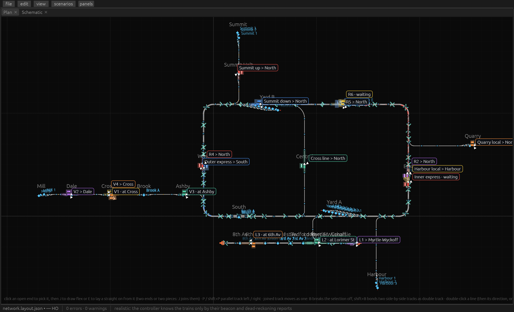

# trainbrain

Layout design, train planning and simulation for a fully autonomous model railway. Rust, with its UI on [imfram](https://github.com/arcadeperfect/imfram) (egui).



- **Track editor**: lay HO / N sectional and flex track on a to-scale plan, with snapping, points, crossovers, double track and gradients
- **Three views**: plan (track or signal-box lines), schematic, and 3D
- **Lines, stations and timetables**: define services and let trains run them
- **Simulation**: many trains routed and dispatched at once, with block reservation, passing and parking
- **Realistic mode**: the controller knows trains only from beacon and dead-reckoning reports, as the real hardware will
- **MCP server**: Claude can build layouts and drive trains

```
cargo run --release -p trainbrain-app -- samples/network.layout.json
```

Full guide: [docs/MANUAL.md](docs/MANUAL.md). Licence: [GPL-3.0](LICENSE).
